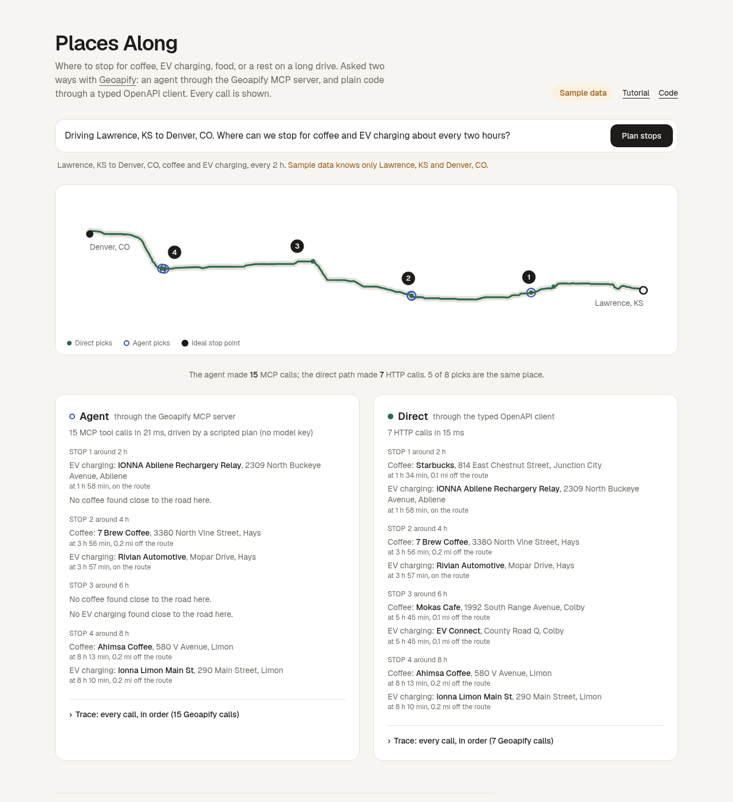

# Places Along

**Where to stop for coffee, EV charging, food, or a rest on a long drive, answered two ways with [Geoapify](https://www.geoapify.com/).**

Type a trip like *"Driving Lawrence, KS to Denver, CO. Where can we stop for coffee and EV charging about every two hours?"* Two columns answer it:

- **Agent**: a model plans the work and calls Geoapify tools through the [Geoapify MCP server](https://apidocs.geoapify.com/docs/mcp/). Its final stop list may only use places a tool returned.
- **Direct**: plain code calls the Geoapify REST APIs through a client typed from [Geoapify's OpenAPI specs](https://github.com/geoapify/geoapify-openapi-specs).

Every Geoapify call on both sides is shown in a trace, with its arguments, result summary, and time. A map and a one-line comparison sit on top.



Built for the [Geoapify Open Geospatial Program](https://www.geoapify.com/open-geospatial-program/), Batch #2. The full write-up is the **[tutorial](docs/TUTORIAL.md)** (also at `/tutorial` in the app), including how to connect the Geoapify MCP server to Cursor and Claude Code with the exact prompts.

## Status

Demo: **[places-along.vercel.app](https://places-along.vercel.app)** (sample mode until the Geoapify key is set).

| | |
| --- | --- |
| Sample mode (no keys) | Working, tested |
| Live Geoapify (REST and MCP) | Code complete; awaiting a live run with the program API key |
| Model-driven agent (OpenRouter) | Code complete and tested against a scripted fake model; live run pending |

Sample mode is honest about what it is: the route is from the public OSRM demo server and the places from OpenStreetMap, not from Geoapify. Every screen says "Sample data".

## Architecture

```
 question ──► parseTrip ──┬──► Agent path                                   ┌─► trace
                          │     official MCP client (Streamable HTTP)       │
                          │     ──► https://api.geoapify.com/v1/mcp         │
                          │         geocode_address, calculate_route,       │
                          │         measure_geometry, search_places          │
                          │     model (OpenRouter) or scripted driver        │
                          │     answer kept only if a tool returned it ─────┤
                          │                                                  ├─► stops ─► map + columns
                          └──► Direct path                                   │
                                openapi-fetch + types from Geoapify OpenAPI  │
                                GET /v1/geocode/search  x2                   │
                                GET /v1/routing         x1                   │
                                POST /v2/places (polyline filter) per stop ──┘
                                shared planner (src/lib/plan.ts)
```

| Path | File | What it does |
| --- | --- | --- |
| `src/lib/agent.ts` | Agent harness | Tool loop, route-geometry references, answer validation, scripted driver |
| `src/lib/mcp/connect.ts` | MCP session | Official `@modelcontextprotocol/client`, key in `x-api-key` |
| `src/lib/direct.ts` | Direct path | Geocode, route, places per stop window |
| `src/lib/geoapify/client.ts` | Typed REST client | openapi-fetch over generated types, trace middleware |
| `src/lib/geoapify/generated/` | Generated | `pnpm gen:client` from `openapi/*.json` |
| `src/lib/plan.ts` | Planner | Stop windows and picks, shared by both paths |
| `src/lib/sample.ts`, `src/lib/mcp/sample-server.ts` | Sample mode | Stand-ins that answer in Geoapify's response shapes |
| `prompts/` | Prompts | The agent's system prompt and the client prompts from the tutorial |

## Setup

Requirements: Node.js 20+, pnpm 10.

```bash
git clone https://github.com/Joe-Simo/places-along
cd places-along
pnpm install
pnpm dev                 # http://localhost:3000
```

With no keys this runs in sample mode. To use Geoapify:

```bash
cp .env.example .env.local
```

| Variable | Required | Purpose |
| --- | --- | --- |
| `GEOAPIFY_API_KEY` | for live data | Geoapify key from [myprojects.geoapify.com](https://myprojects.geoapify.com/). Read from the environment only; never commit it. |
| `OPENROUTER_API_KEY` | no | Lets a model drive the agent. Without it the agent follows a scripted plan with the same tools. |
| `PLACES_ALONG_MODELS` | no | Comma-separated OpenRouter model ids (free models by default). |
| `PLACES_ALONG_DAILY_LIVE_RUNS` | no | Live runs per server instance per day (default 60), to protect free quotas. |

## Scripts

| Command | What it does |
| --- | --- |
| `pnpm dev` / `pnpm build` / `pnpm start` | Next.js |
| `pnpm test` | Vitest: parser, geometry, planner, both paths end to end in sample mode, house style |
| `pnpm typecheck` / `pnpm lint` | TypeScript and ESLint |
| `pnpm gen:client` | Regenerate types and the MCP tool catalog from `openapi/` |
| `pnpm smoke` | With `GEOAPIFY_API_KEY` set: one live run of both paths, printed as a report |
| `node scripts/build-sample.mjs` | Rebuild the sample data from OSRM and OpenStreetMap |

## Deploy

Any Node host works. On Vercel: import the repo, set `GEOAPIFY_API_KEY` (and optionally `OPENROUTER_API_KEY`) as environment variables, deploy.

## Also in this repo

- [docs/TUTORIAL.md](docs/TUTORIAL.md): the tutorial
- [LESSONS.md](LESSONS.md): what needed human guidance while building it
- [FEEDBACK.md](FEEDBACK.md): concrete notes on Geoapify's OpenAPI specs and MCP tools
- [prompts/](prompts/): agent instructions and client prompts

## Credits and license

Location data and APIs by [Geoapify](https://www.geoapify.com/), built on [OpenStreetMap](https://www.openstreetmap.org/copyright) (data (c) OpenStreetMap contributors, ODbL). Vendored OpenAPI specs (c) Geoapify, MIT. Sample route from the [OSRM](https://project-osrm.org/) demo server.

Places Along is an independent project, not made or endorsed by Geoapify. Code: [MIT](LICENSE).
