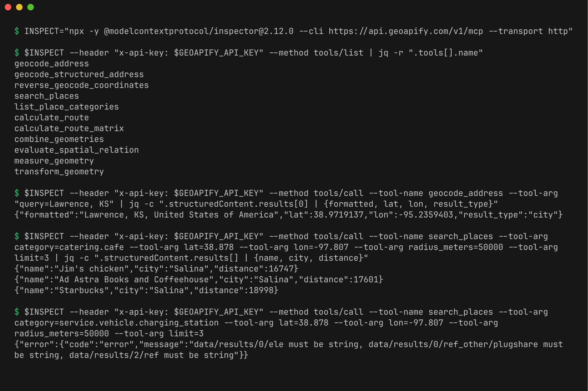
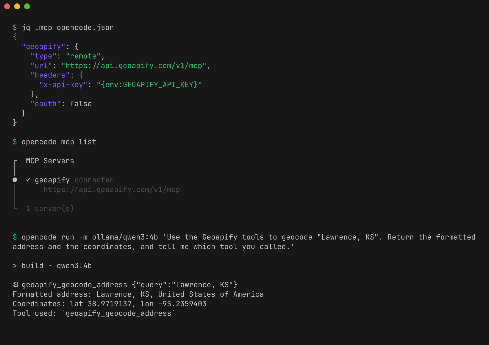
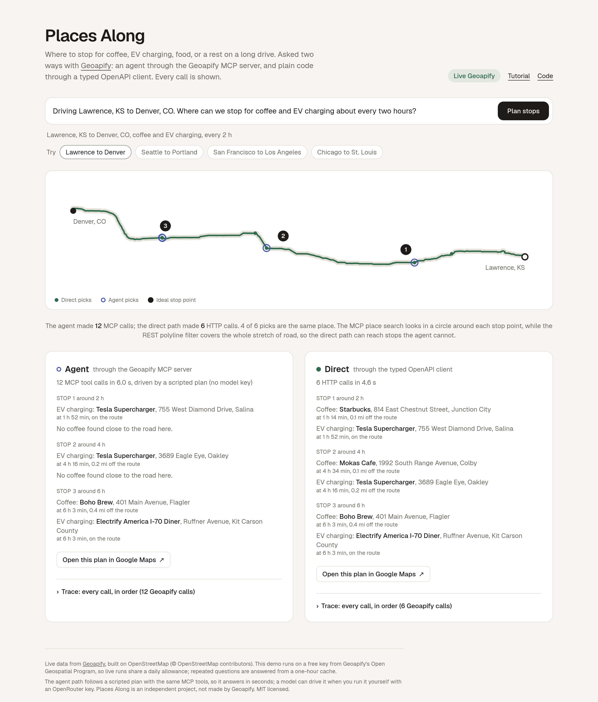
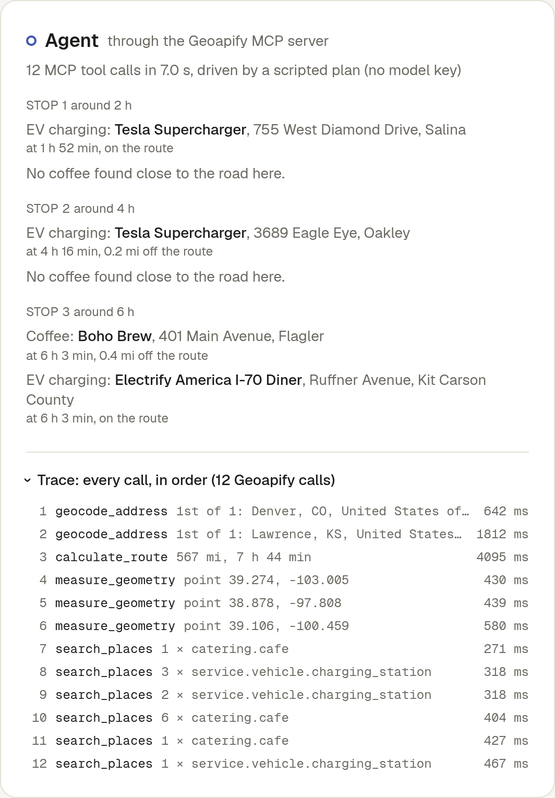
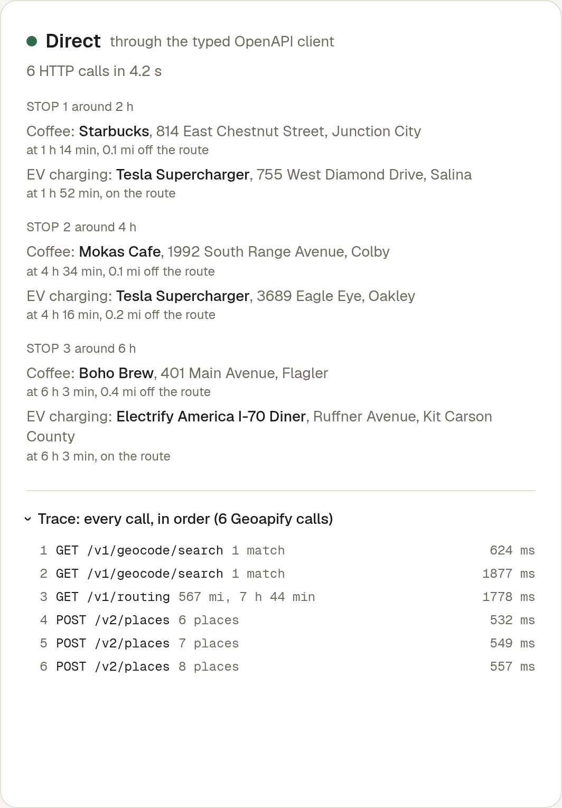

# Plan stops along a route with Geoapify: an MCP agent and a typed OpenAPI client, side by side

You are driving Lawrence, Kansas to Denver, Colorado, more than 500 miles on I-70, and you want coffee and an EV charger about every two hours. This tutorial answers that question with [Geoapify](https://www.geoapify.com/) in two ways and compares them honestly:

1. **Agent path.** An AI model plans the work and calls Geoapify tools through the [Geoapify MCP server](https://apidocs.geoapify.com/docs/mcp/). Every tool call is logged.
2. **Direct path.** Plain TypeScript calls the Geoapify REST APIs through a client whose types are generated from [Geoapify's OpenAPI specs](https://github.com/geoapify/geoapify-openapi-specs).

Part A needs no code: it connects the Geoapify MCP server to two clients we ran, MCP Inspector and OpenCode with a local model, shows the config for Cursor and Claude Code, and gives you the exact prompts. Parts B to D walk through the open source app, [Places Along](https://github.com/Joe-Simo/places-along), which runs both paths side by side.

> **What was actually tested (Oct 22, 2026, with a live Geoapify key).** Everything in Parts B to D ran against the live Geoapify APIs and MCP server, and the [hosted demo](https://places-along.vercel.app) runs on live data. In Part A, **MCP Inspector and OpenCode were run**; their screenshots and transcripts are real, and the results below are what the server returned. **Cursor and Claude Code were not run.** Their config follows Geoapify's [client setup guide](https://apidocs.geoapify.com/how-to/api-tooling-ai/connect-ai-client-mcp/) and each client's documented format. Keys are hidden everywhere.

**Contents**

- [What you need](#what-you-need)
- [Part A: connect the Geoapify MCP server to your AI client](#part-a-connect-the-geoapify-mcp-server-to-your-ai-client), with [the prompts](#the-prompts) and [what the calls really return](#what-those-calls-really-return)
- [Part B: the agent path in code](#part-b-the-agent-path-in-code)
- [Part C: the direct path with a typed client from OpenAPI](#part-c-the-direct-path-with-a-typed-client-from-openapi)
- [Part D: what the comparison shows](#part-d-what-the-comparison-shows)
- [Going public: protect your key and the free plan](#going-public-protect-your-key-and-the-free-plan)
- [Run it yourself](#run-it-yourself) and [Troubleshooting](#troubleshooting)

## What you need

- A Geoapify API key. Create a project at [myprojects.geoapify.com](https://myprojects.geoapify.com/) and copy its key.
- For Part A: Node.js 20 or newer for MCP Inspector, and [OpenCode](https://opencode.ai) with [Ollama](https://ollama.com) for a local model. Or Cursor or Claude Code.
- For Parts B to D: Node.js 20 or newer and pnpm. Optional: an [OpenRouter](https://openrouter.ai/) key, so the agent path is driven by a model rather than a script.

Keep the key in an environment variable named `GEOAPIFY_API_KEY`. Do not paste it into chat, into a committed file, or into a screenshot.

```bash
export GEOAPIFY_API_KEY="your key here"   # in the shell that starts your editor or CLI
```

## Part A: connect the Geoapify MCP server to your AI client

The Geoapify MCP server is a remote HTTP (Streamable HTTP) server. It authenticates with your API key and does not support OAuth. Send the key in an `x-api-key` header. These are the values every client needs:

| Setting | Value |
| --- | --- |
| Name | `geoapify` |
| Transport | Remote HTTP / Streamable HTTP (not stdio, not SSE) |
| URL | `https://api.geoapify.com/v1/mcp` |
| Header | `x-api-key: <your key, from an environment variable>` |

The server exposes eleven tools: `geocode_address`, `geocode_structured_address`, `reverse_geocode_coordinates`, `search_places`, `list_place_categories`, `calculate_route`, `calculate_route_matrix`, `combine_geometries`, `evaluate_spatial_relation`, `measure_geometry`, and `transform_geometry`. A stops-along-the-route question uses five of them.

`initialize` and `tools/list` cost no credits. Each `tools/call` is billed like the Geoapify API call behind it ([Geoapify docs](https://apidocs.geoapify.com/how-to/api-tooling-ai/connect-ai-client-mcp/)).

### MCP Inspector (tested)

[MCP Inspector](https://github.com/modelcontextprotocol/inspector) is the MCP project's own test client. Its CLI mode needs no account and no config file, so it is the quickest way to prove that your key and the server work.

1. Install: nothing to install. `npx` fetches it. Tested with version 2.12.0 on Node 20.19.2.
2. Run:

   ```bash
   INSPECT="npx -y @modelcontextprotocol/inspector@2.12.0 --cli https://api.geoapify.com/v1/mcp --transport http"
   $INSPECT --header "x-api-key: $GEOAPIFY_API_KEY" --method tools/list | jq -r ".tools[].name"
   $INSPECT --header "x-api-key: $GEOAPIFY_API_KEY" --method tools/call --tool-name geocode_address \
     --tool-arg "query=Lawrence, KS"
   $INSPECT --header "x-api-key: $GEOAPIFY_API_KEY" --method tools/call --tool-name search_places \
     --tool-arg category=catering.cafe --tool-arg lat=38.878 --tool-arg lon=-97.807 \
     --tool-arg radius_meters=50000 --tool-arg limit=3
   ```

   The point `38.878, -97.807` is two hours into the Lawrence to Denver drive, just west of Salina.

What it returned: all eleven tools; `Lawrence, KS, United States of America` at `38.9719137, -95.2359403`; and three cafes in Salina, 16.7 to 19.0 km away. The same search for `service.vehicle.charging_station` returned an error instead of results (see gotchas).



Full output: [transcripts/inspector-cli.txt](transcripts/inspector-cli.txt).

Gotchas:

- **EV charging results fail validation.** Inspector checks each result against the tool's `outputSchema`, like the official TypeScript client, and prints `data/results/0/ele must be string, ...` instead of the stations. The data arrived; the check failed. See point 2 under "What those calls really return".
- **Quote the header.** Keep `"x-api-key: $GEOAPIFY_API_KEY"` in double quotes so the shell expands the variable and the key never appears in the command you type.
- **Only `tools/call` costs credits.** `tools/list` is free, so it is the safe first check.

### OpenCode with a local model (tested)

[OpenCode](https://opencode.ai) is an open source terminal agent. With [Ollama](https://ollama.com) the model runs on your own machine, so this setup needs no AI account.

1. Install (tested: OpenCode 1.19.4, Ollama 0.40.8):

   ```bash
   npm install -g opencode-ai
   curl -fsSL https://ollama.com/install.sh | sh
   ollama pull qwen3:4b
   OLLAMA_CONTEXT_LENGTH=24576 ollama serve
   ```

2. Create `opencode.json` in an empty folder. This is the file we ran, trimmed to one model. It turns off OpenCode's built-in tools, so a small model sees only the Geoapify tools:

   ```json
   {
     "$schema": "https://opencode.ai/config.json",
     "provider": {
       "ollama": {
         "npm": "@ai-sdk/openai-compatible",
         "name": "Ollama (local)",
         "options": { "baseURL": "http://localhost:11434/v1" },
         "models": { "qwen3:4b": { "name": "Qwen3 4B", "tools": true } }
       }
     },
     "mcp": {
       "geoapify": {
         "type": "remote",
         "url": "https://api.geoapify.com/v1/mcp",
         "headers": { "x-api-key": "{env:GEOAPIFY_API_KEY}" },
         "oauth": false
       }
     },
     "tools": {
       "bash": false, "edit": false, "write": false, "read": false, "glob": false, "grep": false, "list": false,
       "patch": false, "webfetch": false, "websearch": false, "task": false, "todowrite": false, "todoread": false, "skill": false
     }
   }
   ```

3. In that folder, run `opencode mcp list`. It should show `✓ geoapify connected`.
4. Ask:

   ```bash
   opencode run -m ollama/qwen3:4b 'Use the Geoapify tools to geocode "Lawrence, KS". Return the formatted address and the coordinates, and tell me which tool you called.'
   ```



What it returned, on an 8-core CPU with no GPU ([full transcript](transcripts/opencode-ollama.txt)):

| Model | Prompt | Tool calls | Answer | Time |
| --- | --- | --- | --- | --- |
| qwen3:4b | geocode Lawrence | `geocode_address` | Correct: lat 38.9719137, lon -95.2359403 | 4 min 53 s |
| qwen2.5:3b | geocode Lawrence | `geocode_address` | Latitude and longitude swapped | 52 s |
| qwen2.5:3b | geocode Salina, then cafes within 20 km | `geocode_address`, `search_places` | Searched 31 km south of the geocoded point, so it named a cafe in Lindsborg | 57 s |
| qwen3:4b | the same | `geocode_address`, `search_places` with the exact coordinates | None after 20 minutes | stopped |

The second prompt was:

```text
Using only the Geoapify tools: geocode "Salina, KS", then call search_places with category "catering.cafe", the coordinates you got, radius_meters 20000 and limit 3. List each cafe with its name, street, and distance in meters, and say which tool call returned it. Never name a place a tool did not return.
```

Gotchas:

- **Read the tool calls, not only the answer.** OpenCode prints each call as a `⚙` line. That is where the small model's mistakes showed: the swapped coordinates and the search in the wrong town.
- **Small local models are slow on a CPU.** The server connected every time, but qwen3:4b needed minutes per answer, and a retry of the second prompt with `/no_think` made no tool call in 12 minutes. We did not run the full trip prompt (prompt 1) here: it needs about twelve calls and a 5,147-point route. Use a GPU or a larger hosted model for it.
- **Give Ollama a bigger context.** Ollama's default context window was too small for the eleven tool definitions plus the prompt. `OLLAMA_CONTEXT_LENGTH=24576` fixed it.
- **The key syntax differs by client.** OpenCode uses `{env:GEOAPIFY_API_KEY}`, Cursor `${env:GEOAPIFY_API_KEY}`, Claude Code `${GEOAPIFY_API_KEY}`.
- **Tool names get a prefix.** OpenCode shows `geocode_address` as `geoapify_geocode_address`.

### Cursor (config only, not run)

1. Set `GEOAPIFY_API_KEY` in the environment that starts Cursor, then restart Cursor.
2. Create `.cursor/mcp.json` in your project (or merge into the existing one):

   ```json
   {
     "mcpServers": {
       "geoapify": {
         "url": "https://api.geoapify.com/v1/mcp",
         "headers": { "x-api-key": "${env:GEOAPIFY_API_KEY}" }
       }
     }
   }
   ```

3. Open Cursor Settings, find the MCP section, and turn on `geoapify`. You should see its tools listed.
4. Check the file: it must contain `${env:GEOAPIFY_API_KEY}`, never the key itself.

*Not run in Cursor. The same server, URL, and header were tested with MCP Inspector, OpenCode, and the official MCP client: [transcript](transcripts/mcp-official-client.txt).*

### Claude Code (config only, not run)

1. Set `GEOAPIFY_API_KEY` in the shell where you start `claude`.
2. Create `.mcp.json` in the project root (or merge into the existing one):

   ```json
   {
     "mcpServers": {
       "geoapify": {
         "type": "http",
         "url": "https://api.geoapify.com/v1/mcp",
         "headers": { "x-api-key": "${GEOAPIFY_API_KEY}" }
       }
     }
   }
   ```

3. Start `claude` in that folder, approve the project server when asked, then run `/mcp` to see `geoapify` connected. `claude mcp get geoapify` shows the same from the terminal.

*Not run in Claude Code. The same server, URL, and header were tested with MCP Inspector, OpenCode, the official MCP client, and curl: [client transcript](transcripts/mcp-official-client.txt), [curl transcript](transcripts/mcp-curl.txt).*

### Check the connection

In OpenCode, Cursor, or Claude Code, paste this into the chat:

```text
Use the Geoapify tools to geocode "Lawrence, KS". Return the formatted address and the coordinates, and tell me which tool you called.
```

You should see one `geocode_address` call and a result with a formatted address and numeric latitude and longitude. This is what the server returned for that call on Oct 22, 2026 (from the [curl transcript](transcripts/mcp-curl.txt)):

```json
{ "formatted": "Lawrence, KS, United States of America", "lat": 38.9719137, "lon": -95.2359403, "result_type": "city" }
```

If the client reports HTTP 401, the key did not arrive: check the environment variable and restart the client. (Without a key, the endpoint answers `{"statusCode":401,"error":"Unauthorized","message":"Invalid apiKey"}`, even for `initialize`.)

### The prompts

These are the exact prompts Places Along is built around, for any agent client with the server connected. We ran them as plain tool calls (below), not in Cursor or Claude Code, and not prompt 1 in OpenCode.

**1. The trip question.**

```text
Using only the Geoapify tools: I'm driving from Lawrence, KS to Denver, CO.
Where can I stop for coffee and EV charging about every two hours?

Work like this:
1. Geocode both places with geocode_address.
2. Get a driving route with calculate_route (geometry_format "geojson").
   It returns a MultiLineString. measure_geometry "along" only accepts a LineString,
   so pass {"type": "LineString", "coordinates": <the route's first and only line>}.
3. Work out the points along the route at 2 h, 4 h, 6 h, and so on (stop no later than
   20 minutes before arrival), using measure_geometry with operation "along".
4. At each point, search with search_places for category "catering.cafe" and for
   "service.vehicle.charging_station", radius_meters 50000.
5. For each stop, pick the closest good option of each kind.

Answer with a numbered stop list: stop time, place name, town, and the tool call each pick came from.
Never name a place that a tool did not return.
```

**2. Show your work.** Ask this right after the answer:

```text
List every Geoapify tool call you made, in order, with its arguments (shorten long coordinate arrays),
and for each stop say which search_places call returned it.
```

**3. Change one thing.**

```text
Same trip, but I also want a proper meal at the stop closest to the halfway point.
Use search_places with "catering.restaurant" there, and keep everything else the same.
```

**4. When a category is unknown.**

```text
Before searching, call list_place_categories and tell me which exact category keys fit
"a place to rest on a road trip". Then use them for the stops in my last trip.
```

What to expect: two `geocode_address` calls, one `calculate_route`, one `measure_geometry` per stop, and one `search_places` per stop and category. The live route is 567 miles and 7 h 44 min, so there are three stops (2 h, 4 h, 6 h) and 2 + 1 + 3 + 6 = 12 tool calls. `search_places` takes one category per call, which is why the count grows with every kind of stop you ask for.

### What those calls really return

We ran exactly these calls, in this order, with the official MCP TypeScript client and a live key. The full output is in [transcripts/mcp-official-client.txt](transcripts/mcp-official-client.txt); `pnpm transcript` reproduces it. Three things from that run matter for any client:

1. **The route needs flattening.** Passing `calculate_route`'s geometry straight to `measure_geometry` fails:

   ```text
   [4] tools/call measure_geometry {"operation":"along","geometry":{"type":"MultiLineString","coordinates":["[5147 coordinate pairs]"]},"distance":100,"units":"kilometers"}
       error (434 ms): {"statusCode":400,"error":"Bad Request","message":"geometry.type must be one of LineString"}
   ```

   That is why prompt 1 tells the model to send a `LineString`.

2. **A validating client can reject charging results.** The server now publishes an `outputSchema` for every tool, and the official TypeScript client checks each result against it. EV charging results carry OpenStreetMap tags as numbers where the schema says string, so the client throws:

   ```text
   [7] tools/call search_places {"category":"service.vehicle.charging_station","lat":38.878...,"lon":-97.807...,"radius_meters":50000,"limit":5}
       client error (362 ms): Structured content does not match the tool's output schema: data/results/0/ele must be string, data/results/0/ref_other/plugshare must be string, data/results/2/ref must be string
   ```

   Cafe searches passed. MCP Inspector fails the same way. We did not run an EV search in OpenCode, Cursor, or Claude Code. If your client shows this error, the data arrived; it is the check that failed. Places Along keeps the result and notes the mismatch in its trace (Part B).

3. **The route geometry is big.** This route has 5,147 coordinate pairs. In a chat client the model has to carry that line between `calculate_route` and every `measure_geometry` call, which costs a lot of context and can go wrong. If your client struggles, the app approach in Part B avoids it.

## Part B: the agent path in code

Places Along runs the same workflow inside a Next.js route handler. The pieces, in [`src/lib`](https://github.com/Joe-Simo/places-along/tree/main/src/lib):

**Connect with the official MCP client** ([`mcp/connect.ts`](https://github.com/Joe-Simo/places-along/blob/main/src/lib/mcp/connect.ts)):

```ts
import { Client, StreamableHTTPClientTransport } from "@modelcontextprotocol/client";

const transport = new StreamableHTTPClientTransport(new URL("https://api.geoapify.com/v1/mcp"), {
  requestInit: { headers: { "x-api-key": process.env.GEOAPIFY_API_KEY! } },
});
const client = new Client({ name: "places-along", version: "0.1.0" });
await client.connect(transport);
const { tools } = await client.listTools();
```

**Offer the model only the tools it needs.** Geoapify's guide advises enabling only what a workflow uses. The app passes five tools to the model as OpenAI-style functions:

```ts
const AGENT_TOOLS = ["geocode_address", "calculate_route", "measure_geometry", "search_places", "list_place_categories"];
```

**Give the model simple schemas, and tidy what it sends.** `measure_geometry` publishes eight operations as one `oneOf`. On the live run, a free model given that schema sent the geometry as a JSON string and the distance as a string, and all six calls failed. The app now shows the model only the `along` branch, as a flat object schema with Geoapify's own descriptions, and parses JSON-in-a-string and numeric strings before calling. The next run's calls all succeeded.

**Report schema mismatches instead of failing.** The client is created with a validator that runs the same check as the default one but only records a mismatch, which then shows in the trace (see Part A, point 2).

**Keep big geometry out of the model's context.** When `calculate_route` returns, the app stores the geometry and shows the model a reference instead: `{"geometry": {"ref": "route", "points": 198}}`. When the model later calls `measure_geometry` with `"geometry": {"ref": "route"}`, the app swaps the real line back in, as a `LineString`, before the call goes to Geoapify. The trace still shows the real call. Search results are trimmed the same way, to name, address, coordinates, distance, and `place_id`.

**Only trust what a tool returned.** The model's final answer is JSON with a `place_id` for every stop. The app keeps a stop only if a `search_places` result in this run returned that place, and lists any dropped names under the result. If the model's answer is unusable, the app falls back to its shared planner over the places the agent's own calls found, and says so.

**No model key?** The agent path then follows a scripted plan: the same tools in the same order, with no model. The page labels which driver ran. The hosted demo uses the scripted plan: on our live runs, free OpenRouter models took 45 to 70 seconds and sometimes timed out before answering, which is too slow for a public page. Set `OPENROUTER_API_KEY` locally to watch a model drive it.

The system prompt is in [`prompts/agent-system.md`](https://github.com/Joe-Simo/places-along/blob/main/prompts/agent-system.md).

## Part C: the direct path with a typed client from OpenAPI

Geoapify publishes OpenAPI 3.1 specs for every API. Places Along vendors three of them and generates types with [openapi-typescript](https://openapi-ts.dev/), then calls the API through [openapi-fetch](https://openapi-ts.dev/openapi-fetch/), the approach Geoapify's own [OpenAPI article](https://www.geoapify.com/geoapify-openapi-specifications-ai-coding-tools/) uses.

```bash
pnpm add openapi-fetch
pnpm add -D openapi-typescript
pnpm exec openapi-typescript openapi/routing.json -o src/lib/geoapify/generated/routing.ts --default-non-nullable=false
```

`--default-non-nullable=false` keeps request fields that have a default (like `limit`) optional, which is what the spec means. [`scripts/gen-client.mjs`](https://github.com/Joe-Simo/places-along/blob/main/scripts/gen-client.mjs) runs it for every spec.

The whole direct path is three kinds of request ([`geoapify/client.ts`](https://github.com/Joe-Simo/places-along/blob/main/src/lib/geoapify/client.ts)):

1. `GET /v1/geocode/search` for each end of the trip.
2. `GET /v1/routing` once.
3. `POST /v2/places` once per stop, with a **polyline filter**: the stretch of road where that stop could be, buffered by 3 km, and every requested category in one request.

```ts
const { data } = await places.POST("/places", {
  body: {
    categories: ["catering.cafe", "service.vehicle.charging_station"],
    filter: { type: "polyline", geometry: { type: "LineString", coordinates: stretch }, buffer: 3000 },
    limit: 500,
  },
});
```

Three things that took care to get right:

- **Coordinate order.** Routing takes waypoints as `latitude,longitude`. GeoJSON, and so the Places polyline filter, is `[longitude, latitude]`.
- **Array style.** The routing spec declares `waypoints` as `style: pipeDelimited`. openapi-fetch builds requests from the types, not from the spec's styles, so by default it sends `waypoints=a&waypoints=b`. Set it on the client:

  ```ts
  createClient<paths>({ baseUrl: "https://api.geoapify.com/v1", querySerializer: { array: { style: "pipeDelimited", explode: false } } });
  ```

- **The Places request body type.** The spec says a request needs `filter` or `bias` using an `anyOf` of `required` lists. openapi-typescript 7.13 turns that into `... | unknown`, which accepts anything. The app types its one body shape from the generated parts instead. Details are in [FEEDBACK.md](https://github.com/Joe-Simo/places-along/blob/main/FEEDBACK.md).

Both paths hand their places to the same planner ([`plan.ts`](https://github.com/Joe-Simo/places-along/blob/main/src/lib/plan.ts)). For each stop it picks the place that best balances closeness to the ideal time against distance off the road. So any difference you see between the columns comes from the data each path gathered, not from different planning.

## Part D: what the comparison shows

The sample trip on live Geoapify data, Oct 22, 2026 (coffee and EV charging every two hours, 567 miles, three stops):

| | Agent (MCP) | Direct (OpenAPI client) |
| --- | --- | --- |
| Geoapify calls | 2 geocode + 1 route + 3 along + 6 searches = **12** | 2 geocode + 1 route + 3 places = **6** |
| Time | about 5 s (scripted driver) | about 4 to 6 s |
| Stop slots filled | **4 of 6** | **6 of 6** |
| Who decides the calls | the model (or the scripted plan) | the code |
| Search area per stop | a 50 km circle around one point | a 3 km band along the whole stretch where the stop may fall |
| Grows with | stops x categories | stops |
| Best for | open questions, exploring, changing the plan mid-conversation | a fixed product feature that has to be fast, cheap, and repeatable |

All 4 of the agent's picks are also among the direct path's 6, so the two paths agree where both found something. The gap is the search area. At the two-hour point the agent's circle is centered just west of Salina, Kansas. It finds six cafes, but the nearest to the road is 3.8 km off I-70 and the planner only takes places within 3 km, so coffee comes back empty. The direct path's band covers the whole stretch the stop may fall in (about 1 h 12 min to 2 h 48 min into the drive) and finds a Starbucks in Junction City 199 m off the highway, at 1 h 14 min. At four hours, in western Kansas, the only cafe within 50 km of the agent's point is in Oakley, 39 km away; the band finds Mokas Cafe in Colby, 211 m off the road, at 4 h 34 min. Each Places request returned places spread over its whole 190 km stretch, all inside the 3 km buffer.

You can widen the agent's circle or search more points per stop, but each costs more calls. The honest summary: MCP makes the first answer fast to build and easy to change, and every step is visible. The typed REST client makes the answer cheaper, more complete, and more predictable once you know the question.

### The app's own trace

These screenshots are from the hosted demo on live data. Every call either path makes is listed with its arguments, result, and time.







The page also turns a plan into something you can drive. Each stop's name links to the place on OpenStreetMap, using the coordinates Geoapify returned, and each column ends with a Google Maps driving link through its picks in order. That link needs no key: it is a [Maps URL](https://developers.google.com/maps/documentation/urls/get-started) built from the stops' `lat,lon` ([`src/lib/links.ts`](https://github.com/Joe-Simo/places-along/blob/main/src/lib/links.ts)), capped at the nine waypoints Maps accepts. Every run also writes the question into the address bar as `?q=`, so a plan can be shared as a link, for example [Seattle to Portland, coffee every hour](https://places-along.vercel.app/?q=Seattle%2C%20WA%20to%20Portland%2C%20OR.%20Coffee%20every%20hour%3F).

## Going public: protect your key and the free plan

A public demo on a free key needs three guards. Places Along uses all of them.

1. **Keep the key on the server.** Every Geoapify call, MCP or REST, runs in a Next.js route handler. The browser only ever talks to `/api/plan`, so the key never reaches it.
2. **Count what you actually spend.** A run is not one request: the sample trip costs 12 MCP tool calls on the agent path and 6 HTTP calls on the direct path. The app counts the Geoapify calls in each run's trace and stops live runs at a daily budget (1,000 by default, against the free plan's 3,000), plus 12 live runs per visitor a day. Repeated questions come from a one-hour cache and cost nothing.
3. **Keep the counters somewhere every instance can see.** Serverless platforms start and stop instances freely, so counters in memory reset without warning, and two instances each count only their own traffic. Places Along keeps them in one small Postgres table (on the hosted demo, a free [Neon](https://neon.com/) database added from the Vercel Marketplace). Geoapify's review of the first version suggested this change.

The per-visitor limit is a single atomic statement, so two runs that arrive together cannot both slip past it ([`src/lib/usage.ts`](https://github.com/Joe-Simo/places-along/blob/main/src/lib/usage.ts)):

```sql
INSERT INTO demo_usage (day, key, n) VALUES ($1, $2, 1)
ON CONFLICT (day, key) DO UPDATE SET n = demo_usage.n + 1 WHERE demo_usage.n < $3
RETURNING n
```

If a row comes back, the run may go ahead; if none does, the visitor is out of runs. The day is the UTC date, and the visitor is a short hash of the IP address, not the address itself.

The database is a guard, not a dependency. Each call has a 2.5 second timeout, and on any error the app counts in memory instead, as it did before, and logs why. A database outage costs some accuracy, never the demo.

## Run it yourself

```bash
git clone https://github.com/Joe-Simo/places-along
cd places-along
pnpm install
pnpm dev            # http://localhost:3000, sample mode
```

Without keys, the app runs in **sample mode**. The route comes from the public OSRM demo server and the places from OpenStreetMap, not from Geoapify, and the page says so. Both paths still run their real request code: the generated REST client and the official MCP client talk to small stand-ins that answer in Geoapify's documented response shapes.

The hosted demo runs on a key from Geoapify's Open Geospatial Program. To go live yourself, get a free key at [myprojects.geoapify.com](https://myprojects.geoapify.com/) (the free plan allows 3,000 requests a day) and add it:

```bash
cp .env.example .env.local
# set GEOAPIFY_API_KEY (and optionally OPENROUTER_API_KEY), then:
pnpm dev
```

Checks: `pnpm test`, `pnpm typecheck`, `pnpm lint`, `pnpm build`.

To share the demo's daily counters across server instances, set `DATABASE_URL` to a Postgres database (see [Going public](#going-public-protect-your-key-and-the-free-plan)). Without it, they are kept in memory.

## Troubleshooting

| Symptom | What to check |
| --- | --- |
| HTTP 401 from the MCP endpoint | The key is missing or wrong. The endpoint returns 401 even for `initialize` without one. |
| The client lists no tools | Transport must be HTTP / Streamable HTTP. Check the server is enabled and approved in the client. |
| Routing returns 400 | Waypoints must be `lat,lon` joined by `|`. Check your client's array style. |
| A category is rejected | Use exact keys from `list_place_categories`, such as `catering.cafe`. |
| `geometry.type must be one of LineString` | `measure_geometry` `along` needs a `LineString`; `calculate_route` returns a `MultiLineString`. Flatten it first. |
| `Structured content does not match the tool's output schema` | Your client validates results against `outputSchema`, and the result broke it (seen on EV charging searches). The data did arrive; see Part A. |
| "Couldn't find" a start or end | Write the place with its state or country, like `Denver, CO`, and end the trip with a full stop or a comma before the kinds of stop. |
| The agent names a place that is not in the trace | Places Along drops it and lists it under the result. Ask the model to cite `place_id`s. |
| "Today's live demo allowance is used up" | The daily request budget or your per-visitor runs are spent. Run it locally with your own key, or raise `PLACES_ALONG_DAILY_GEOAPIFY_REQUESTS` and `PLACES_ALONG_VISITOR_RUNS_PER_DAY`. |

## Further reading

- [Geoapify MCP server docs](https://apidocs.geoapify.com/docs/mcp/) and [client setup guide](https://apidocs.geoapify.com/how-to/api-tooling-ai/connect-ai-client-mcp/)
- [Geoapify OpenAPI specs](https://github.com/geoapify/geoapify-openapi-specs) and [how to generate clients](https://apidocs.geoapify.com/how-to/api-tooling-ai/generate-openapi-clients-sdks/)
- [Places API](https://apidocs.geoapify.com/docs/places/) and [Routing API](https://apidocs.geoapify.com/docs/routing/)
- In this repo: [README](https://github.com/Joe-Simo/places-along#readme), [LESSONS.md](https://github.com/Joe-Simo/places-along/blob/main/LESSONS.md), [FEEDBACK.md](https://github.com/Joe-Simo/places-along/blob/main/FEEDBACK.md), [prompts/](https://github.com/Joe-Simo/places-along/tree/main/prompts)
